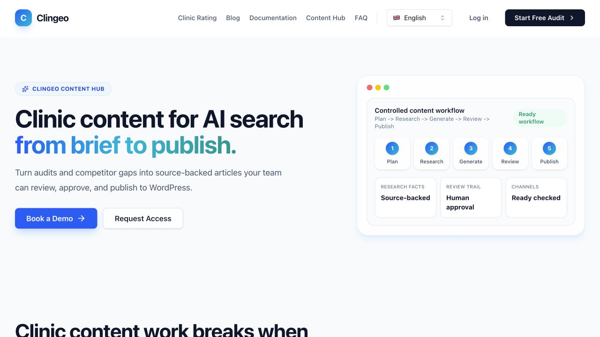

# ClinGEO

**AI visibility and content operations for clinics**

[Explore ClinGEO](https://www.clingeo.com/en) · [Explore Content Hub](https://www.clingeo.com/en/content-hub) · [Back to portfolio](../README.md)

## The product problem

Clinic teams need to understand how their services appear in AI-generated answers and what they should improve next. Visibility analysis becomes more useful when it connects to concrete technical fixes, content priorities and a controlled publishing workflow.

ClinGEO brings those activities into a specialist SaaS product for clinics.

## What the product does

- Analyses clinic and service visibility by location, extracting mentions, domains, positions and competing providers from AI responses.
- Combines technical, content, local and credibility assessments with actionable recommendations.
- Turns audit findings, competitor gaps and manual priorities into content opportunities and briefs.
- Supports research-backed article generation, editing, rendered previews, version comparison and reviewer approval.
- Checks publishing readiness, integrates with WordPress and retains publication history and performance context.

Human review stays in the editorial workflow. Visibility signals inform decisions; they do not guarantee recommendations by an AI provider.

## Product and technical work

My contribution spans the proposition, product logic, APIs, analytics, automation, content workflows and releases. A central product decision is to connect diagnosis to action: the same clinic context should help explain visibility gaps and inform what the team writes or changes next.

The implementation separates reusable visibility logic and content components from application orchestration. The content pipeline keeps briefs, research context, drafts, review state and publication readiness connected across stages.

**Technology:** TypeScript, Next.js, React, Supabase/PostgreSQL, LLM APIs, retrieval patterns, WordPress integrations and Vercel.

## Public preview

Public Content Hub page, captured on 13 October 2026. This is the public product presentation; authenticated clinic workspaces are not shown.

## Implementation scale

| Measure                                         |                Count |
| ----------------------------------------------- | -------------------: |
| Selected visibility and content modules         |  88,718 source lines |
| Application source, including shared foundation | 294,688 source lines |
| Separate test source                            | 163,522 source lines |

The measured snapshot was committed on 9 October 2026. The selected-module count covers the visibility engine, reusable Content Hub components and selected content/assistant libraries. It excludes much of the surrounding application UI, API routing and infrastructure.

[Read the measurement methodology](../metrics/README.md). Codebase size is reported separately from authorship, adoption and commercial outcomes. The implementation repository is private.
