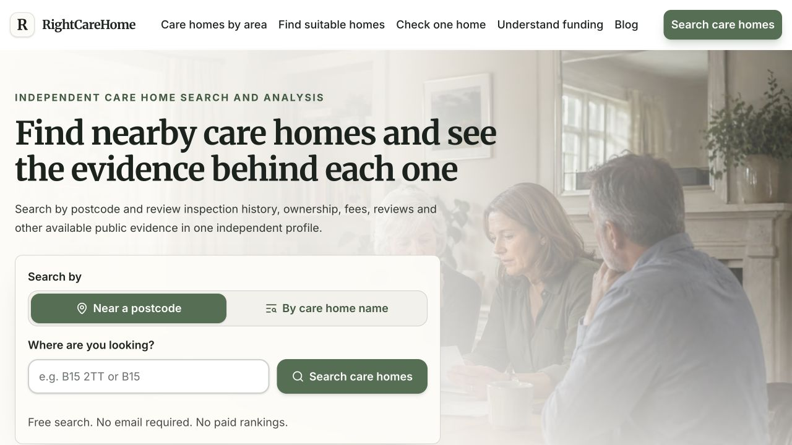

# RightCareHome

**Independent care intelligence for UK families**

[Explore RightCareHome](https://www.rightcarehome.co.uk/) · [Public methodology](https://www.rightcarehome.co.uk/methodology) · [Back to portfolio](../README.md)

## The product problem

Choosing a care home involves quality, suitability, location, costs and funding. Relevant evidence is spread across public records, inspection histories, reviews and local information, and its availability varies from home to home.

RightCareHome brings that evidence into a search and decision-support experience for families.

## What the product does

- Provides geographic search and care-home profiles that bring together available inspection, ownership, financial, review and local evidence.
- Offers a **Care Home Check** for a deeper assessment of one home.
- Supports a **Care Home Matching Report** based on care needs, location and preferences.
- Provides a **Care Home Funding Report** to help families understand relevant costs and potential funding routes.
- Includes practical tools, report workflows and evidence-based questions for the next conversation or visit.

The product distinguishes confirmed information, estimates and gaps in the evidence. Commercial relationships must not affect search positions or assessment conclusions.

## Product and technical work

My work centres on building a data-rich decision-support product: shaping the journeys, domain logic, integrations and data/content workflows that make fragmented information useful to families.

The implementation uses shared domain engines for matching, geographic search, funding calculations, enrichment, evidence handling and report generation. Product-specific adapters consume those engines so that multiple reports and tools can reuse the same underlying logic.

An important design principle is to keep calculations and evidence handling explicit, and use AI-assisted interpretation where it helps explain the information. Missing evidence needs to remain visible in the resulting experience.

**Technology:** TypeScript, Next.js, React, Supabase/PostgreSQL, data integrations, background jobs and Vercel.

## Public preview

Public search page, captured on 13 October 2026. No customer assessment or private report is shown.

## Implementation scale

| Measure                                         |                Count |
| ----------------------------------------------- | -------------------: |
| Selected domain engines and product adapters    |  82,640 source lines |
| Application source, including shared foundation | 461,443 source lines |
| Separate test source                            | 132,821 source lines |

The measured snapshot was committed on 12 October 2026. Selected modules cover the domain-engine and product-adapter directories; the wider source count also includes application journeys, administration and shared infrastructure.

[Read the measurement methodology](../metrics/README.md). These are codebase measures, with no implied clinical accuracy, funding entitlement, customer adoption or individual authorship. The implementation repository is private.
